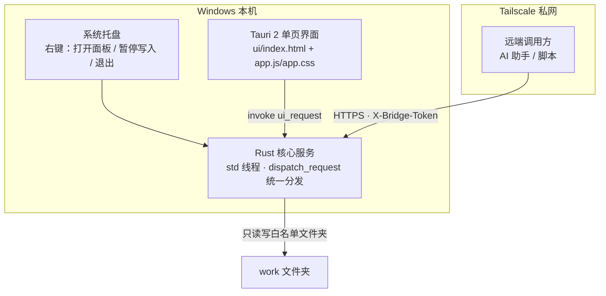

<p align="center">
  
</p>

<h1 align="center">Pylon</h1>

<p align="center">
  <strong>让远端 AI 安全地走进你的 Windows 文件夹</strong>
</p>

<p align="center">
  本地白名单文件服务 · 白名单命令执行 · 三档权限 · 人工审批 · 写前快照 · 一键回滚
</p>

<p align="center">
  <a href="https://github.com/D-OneXXX/Pylon"></a>
  <a href="https://github.com/D-OneXXX/Pylon/blob/main/LICENSE"></a>
  <a href="https://www.rust-lang.org/"></a>
  
  
</p>

---

## ✨ 为什么是 Pylon

你想让云端的 AI 助手直接帮你改本地代码、跑编译测试，而不是来回复制粘贴。但把一台电脑的读写权限交给远端，唯一能接受的方式是**边界足够硬**：

| 担忧 | Pylon 的回答 |
| --- | --- |
| 它会不会动我别的文件夹？ | 不会。白名单之外一步都走不出去（`..`、绝对路径、盘符、UNC、软链接、NTFS 备用数据流全部拦截） |
| 它会不会跑危险命令？ | 跑不了。直接调进程、不经过 shell；`cmd` / `powershell` / `bash` 三档权限下全部禁 |
| 它会不会偷偷改配置？ | 改不了。`bridge-config.json` 永远不能远程改，读保护连列表里都不显示 |
| 改错了怎么办？ | 一键回滚。每次写文件自动拍保护快照，面板点一下就还原，还能二次反悔 |
| 我能不能随时叫停？ | 能。托盘右键「暂停云端写入」即熔断，顶栏三档权限随时切换、即时生效 |

## 🚀 快速开始

### 环境要求

- Windows 11（64 位）
- Rust MSVC 工具链（[rustup.rs](https://rustup.rs)，选 MSVC 版）+ Visual Studio Build Tools（含 C++ 工作负载与 Windows SDK）
- [Tailscale](https://tailscale.com/)（两端 Connected，桥监听 `0.0.0.0:8765`）

### 三步跑起来

```cmd
:: 1. 检查能不能编过
cargo check

:: 2. 复制配置模板，填 token 和第一个文件夹
copy bridge-config.example.json bridge-config.json
notepad bridge-config.json
```

```powershell
# 生成一个 token（PowerShell，每次结果都不一样，用你自己的那串）
[guid]::NewGuid().ToString('N')
```

双击 `start.bat`：它会检查 cargo、没有配置就从示例复制一份，然后 `cargo build --release`（第一次编译要等一阵子）。启动后打开 Pylon 窗口，任务栏角落多一个托盘图标，右键托盘可以打开面板、暂停云端写入、退出 Pylon。

也可以在设置弹窗里填配置：点右上角 `[设置]`，Token 行点「重新生成」，工作区行点「浏览…」选文件夹，点「保存并热重载」，0.5 秒内生效，不用重启。

确认跑起来了：

```powershell
$h = @{ "X-Bridge-Token" = "你的token" }
Invoke-RestMethod -Uri "http://127.0.0.1:8765/health" -Headers $h
```

## 🏗️ 架构



```text
src/
├── config.rs    读 bridge-config.json：白名单、审批表、防穿越
├── bridge.rs    std TcpListener 做 HTTP：health / list / read / write / run / patch / search / tasks
├── tasks.rs     异步长任务引擎（Job Object + 双管道读线程，offset 增量轮询）
├── network.rs   HTTP 监听热切换
├── job.rs       Windows Job Object 进程树清理
├── tray.rs      Windows 专属：系统托盘（原生 Win32 消息循环）
├── tauri_ui.rs  Tauri 2 全宽单页窗口（invoke ui_request 同路分发，仅本机）
└── main.rs      入口：读配置 → 起服务 → 打开窗口 → 托盘驻留（Linux 下只跑服务）
```

Linux 下只编译核心服务层（bridge / config / network / tasks / job），GUI 全部 `#[cfg(windows)]` 隔开，`cargo check` / `cargo test` 零系统库依赖。

## ⚙️ 配置

`bridge-config.json` 关键字段（完整模板见 [`bridge-config.example.json`](bridge-config.example.json)）：

| 字段 | 说明 |
| --- | --- |
| `token` | 桥的密码，32 位随机串；只有知道它的人才能调用接口。怀疑泄露就去设置弹窗重新生成一个 |
| `roots` | 白名单根目录，如 `{"work": "C:\\path\\to\\your\\workspace"}`；先拿一个空文件夹试，别直接拿整个“文档”或桌面 |
| `run_allowlist` | `/api/run` 的白名单，argv 必须以其中一条逐 token 精确开头 |
| `run_asklist` | 需人工审批的表，默认 `[["git", "push"], ["python"]]` |
| `permission_mode` | 三档权限：`ask_always`（请求批准）/ `smart_auto`（帮我批准，默认）/ `full_access`（完全访问） |
| `main_file` | 可选，绑定的主程序单文件（相对 work 根目录或绝对路径） |
| `require_hmac` | 为 `true` 时改认 `X-Bridge-Timestamp` + `X-Bridge-Signature`（HMAC-SHA256 防重放） |
| `host` / `port` | 默认 `0.0.0.0:8765`，一般不用改 |

## 📡 HTTP API

所有接口（除 `GET /` 与 `/health` 外）都要带 `X-Bridge-Token` 请求头。`root` 是 `roots` 里的别名（如 `work`），`path` 是相对路径，永远锁在白名单根目录内。

| 接口 | 说明 |
| --- | --- |
| `GET /health` | 健康检查：`{"ok": true, "version": "2.3.3", "roots": ["work"]}` |
| `GET /` | 小 JSON 状态（仅本机） |
| `GET /api/list?root=&path=` | 列目录 |
| `GET /api/read?root=&path=` | 读文本文件（单文件 2MB 上限） |
| `POST /api/write` | 写文本文件（写前自动拍快照） |
| `POST /api/mkdir` | 建目录 |
| `POST /api/rename` | 改名 / 移动（目标需审批） |
| `POST /api/trash` | 软删除进 `.pylon_trash/`（可回滚） |
| `GET /api/read_base64?root=&path=` | 读二进制（上限 10MB） |
| `POST /api/write_base64` | 写二进制（上限 10MB） |
| `GET /api/search?root=&path=&query=` | 代码检索（支持 `is_regex`、`case_sensitive`，最多 100 条） |
| `POST /api/patch` | 行级修补（`search` 必须恰好出现 1 次；CRLF / LF 无感匹配，写回保留原换行符） |
| `POST /api/run` | 白名单命令执行（见下） |
| `GET /api/program` | 读绑定的主程序单文件（附 `sha256` / `line_count` / `last_run`） |
| `POST /api/program` | 覆写或行级修补主程序；支持 `expected_sha256` 乐观锁（不匹配 409）与 `run_argv` 改后即跑 |
| `GET /api/changes?since_ms=` | 增量变更感知（列出最近改动的文件） |
| `POST /api/tasks/start` | 启动异步长任务（并发上限 8，超限 429） |
| `GET /api/tasks/status?id=&tail_bytes=` | 任务状态 + stdout/stderr 尾部（UTF-8 边界对齐） |
| `GET /api/tasks/list` | 列出任务 |
| `POST /api/tasks/stop` | 停止任务（关 Job 句柄，OS 清进程树） |

`/ui/*`（`/ui/state`、`/ui/heatmap`、`/ui/activity`、`/ui/approvals`、`/ui/tasks`、`/ui/save-config` 等）只供本机 Tauri 界面经 `invoke('ui_request')` 内部调用，HTTP Socket 收到一律 403。

### `/api/run` 白名单命令执行

```bash
curl -X POST "http://127.0.0.1:8765/api/run" \
  -H "X-Bridge-Token: 你的token" -H "Content-Type: application/json" \
  -d '{"root":"work","path":"proj","argv":["cargo","test"],"timeout_secs":300}'
```

- `argv` 是字符串数组，如 `["cargo", "test"]`；`path` 是命令的工作目录（相对路径，默认 `"."`）；`timeout_secs` 可选，默认 300 秒，上限 1800 秒。
- 命令本身退出码非 0 时仍返回 200，看 `exit_code` 判断；`stdout` / `stderr` 各最多 512KB（超了截断并标记 `truncated`）。
- 默认白名单：`cargo run / test / check / build`、`cargo --version`、`rustc --version`；`git push` 与 `python` 走审批表，远程调用时要在面板点「批准」才执行（60 秒超时按拒绝）。
- 别用它跑常驻服务：跑完就退出的命令（编译、测试）才合适。

## 🔒 安全模型

- **边界控制，不做沙盒**：白名单防的是“跑别的工具”，不是把 cargo 本身沙盒化——`cargo run / test / check / build` 都会执行白名单文件夹里的代码（build.rs、被跑的程序本身）。桥本来就能往 `work` 里写任意文件，`/api/run` 新开的口子是**让他能直接执行**，而不是只能写。token 仍是唯一门槛，别外泄。
- **不经过 shell**：直接调进程，`&&` / `|` / `>` 只会变成传给命令的字面参数，不会执行。
- **参数消毒**：`python -c` / `python -m`（除 `python -m pip --version` 外）、`git diff --output=...`、`git -c ...` 一律 403；`python` 只能跑白名单内已存在的 `.py` 脚本。
- **路径归一化**：NTFS 语义统一处理（切 `:stream`、剥尾部 `.` / 空格、转小写），读保护、写保护、回收站、重命名、建目录共用同一份判定口径；`resolve_inside` 在入口直接拒绝 `:`、NUL、以根开头的路径。
- **三条红线，三档权限都一样**：`cmd` / `powershell` / `pwsh` / `bash` / `sh` 永远禁；命令的工作目录永远锁在 `work` 文件夹内；`bridge-config.json` 永远不能远程改。
- **写保护**：`read` / `search` / `read_base64` 禁读 `bridge-config.json` 与 `pylon-activity.log`（含大小写 / 尾部点号变体）；敏感文件在目录列表里也不显示。
- **Job Object（Windows）**：每个命令进专属 Job，超时 / 退出时进程树一并被系统清理。
- **可选 HMAC**：`require_hmac: true` 时改认时间戳 + HMAC-SHA256 签名，防重放。

## 🛠️ 开发

```cmd
cargo check          :: 最常用，编过即没错
cargo test           :: 单元测试全绿（Windows 102 项，含 Windows 专属 Job 测试；Linux 100 项）
cargo build --release
```

Linux 下只编译核心服务层，GUI 全部 `#[cfg(windows)]` 隔开，不需要任何系统库。Windows 专属代码的裁决以真机 `cargo check` 为准，云端 Linux 编不过 Windows 专属代码。

版本号四处同步：`Cargo.toml`、`src/bridge.rs` 的 `VERSION` 常量、`tauri.conf.json`、`README.md` 标题。

更详细的内部设计见 [`docs/TECHNICAL.md`](docs/TECHNICAL.md)，使用指引见 [`docs/Pylon使用指引.md`](docs/Pylon使用指引.md)。

## 📄 许可证

[MIT](LICENSE)
