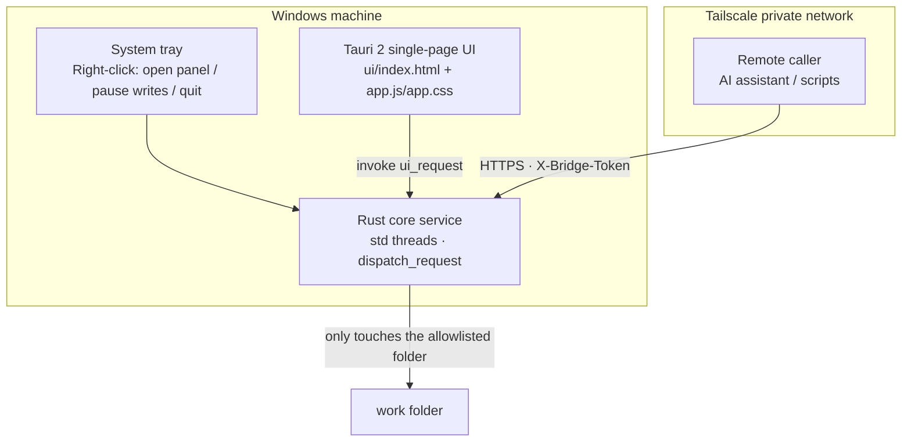

<p align="center">
  
</p>

<h1 align="center">Pylon</h1>

<p align="center">
  <strong>Let a remote AI work inside your Windows folders — safely.</strong>
</p>

<p align="center">
  Local allowlist file service · Allowlist command execution · Three permission levels · Human approval · Snapshots &amp; one-click rollback
</p>

<p align="center">
  <a href="https://github.com/D-OneXXX/Pylon"></a>
  <a href="https://github.com/D-OneXXX/Pylon/blob/main/LICENSE"></a>
  <a href="https://www.rust-lang.org/"></a>
  
  
</p>

<p align="center">
  <a href="README.zh-CN.md">中文版</a>
</p>

---

## ✨ Why Pylon

You want a cloud AI assistant to edit your local code and run builds and tests for you — no more copying and pasting back and forth. But handing a remote agent read/write access to your computer is only acceptable if the boundaries are hard enough:

| Worry | Pylon's answer |
| --- | --- |
| Will it touch my other folders? | No. It cannot step outside the allowlisted folder (`..`, absolute paths, drive letters, UNC paths, symlinks, and NTFS alternate data streams are all blocked) |
| Will it run dangerous commands? | It can't. Commands are spawned directly, never through a shell; `cmd` / `powershell` / `bash` are banned at all three permission levels |
| Will it silently change my config? | No. `bridge-config.json` can never be modified remotely, and it doesn't even show up in directory listings |
| What if it breaks something? | Roll it back. Every file write takes a protection snapshot first; one click in the panel restores it, and you can undo the rollback too |
| Can I stop it at any time? | Yes. Right-click the tray icon and hit "pause cloud writes" to kill-switch it; switch permission levels from the top bar any time, effective immediately |

## 🚀 Quick start

### Requirements

- Windows 11 (64-bit)
- Rust MSVC toolchain ([rustup.rs](https://rustup.rs), MSVC edition) + Visual Studio Build Tools (with the C++ workload and Windows SDK)
- [Tailscale](https://tailscale.com/) (both ends Connected; the bridge listens on `0.0.0.0:8765`)

### Three steps

```cmd
:: 1. Check that it builds
cargo check

:: 2. Copy the config template and fill in your token and first folder
copy bridge-config.example.json bridge-config.json
notepad bridge-config.json
```

```powershell
# Generate a token (PowerShell — every run gives a different one, use your own)
[guid]::NewGuid().ToString('N')
```

Double-click `start.bat`: it checks for cargo, copies the example config if there isn't one, then runs `cargo build --release` (the first build takes a while). Once started, the Pylon window opens and a tray icon appears in the taskbar corner; right-click the tray icon to open the panel, pause cloud writes, or quit Pylon.

You can also fill in the config from the settings dialog: click `[Settings]` in the top right, hit "Regenerate" on the Token row, "Browse…" on the workspace row to pick a folder, then "Save & hot reload" — it takes effect within 0.5 seconds, no restart needed.

Check that it's running:

```powershell
$h = @{ "X-Bridge-Token" = "your-token" }
Invoke-RestMethod -Uri "http://127.0.0.1:8765/health" -Headers $h
```

## 🏗️ Architecture



```text
src/
├── config.rs    Reads bridge-config.json: allowlist, approval list, path-traversal defense
├── bridge.rs    std TcpListener HTTP service: health / list / read / write / run / patch / search / tasks
├── tasks.rs     Async long-task engine (Job Object + dual-pipe reader threads, offset-based polling)
├── network.rs   HTTP listener hot-switching
├── job.rs       Windows Job Object process-tree cleanup
├── tray.rs      Windows-only: system tray (native Win32 message loop)
├── tauri_ui.rs  Tauri 2 full-width single-page window (invoke ui_request, local only)
└── main.rs      Entry: read config → start service → open window → stay in tray (Linux runs the service only)
```

On Linux only the core service layer compiles (bridge / config / network / tasks / job). The GUI is fully behind `#[cfg(windows)]`, so `cargo check` / `cargo test` need no system libraries there.

## ⚙️ Configuration

Key fields of `bridge-config.json` (full template: [`bridge-config.example.json`](bridge-config.example.json)):

| Field | Description |
| --- | --- |
| `token` | The bridge password, a 32-char random string; only whoever knows it can call the API. If you suspect a leak, regenerate it from the settings dialog |
| `roots` | Allowlisted root folders, e.g. `{"work": "C:\\path\\to\\your\\workspace"}`; start with an empty test folder, not your whole Documents or Desktop |
| `run_allowlist` | The `/api/run` allowlist; argv must start with one of these entries, token by token |
| `run_asklist` | Commands that need human approval, default `[["git", "push"], ["python"]]` |
| `permission_mode` | Three levels: `ask_always` (approve everything) / `smart_auto` (approve for me, default) / `full_access` (full access) |
| `main_file` | Optional, the bound main program file (relative to the work root, or absolute) |
| `require_hmac` | When `true`, requests use `X-Bridge-Timestamp` + `X-Bridge-Signature` (HMAC-SHA256 anti-replay) instead of the token |
| `host` / `port` | Default `0.0.0.0:8765`, usually no need to change |

## 📡 HTTP API

Every endpoint except `GET /` and `/health` requires the `X-Bridge-Token` header. `root` is an alias from `roots` (e.g. `work`); `path` is relative and always locked inside the allowlisted root.

| Endpoint | Description |
| --- | --- |
| `GET /health` | Health check: `{"ok": true, "version": "2.3.3", "roots": ["work"]}` |
| `GET /` | Small JSON status (local only) |
| `GET /api/list?root=&path=` | List a directory |
| `GET /api/read?root=&path=` | Read a text file (2 MB limit per file) |
| `POST /api/write` | Write a text file (takes a protection snapshot first) |
| `POST /api/mkdir` | Create a directory |
| `POST /api/rename` | Rename / move (destination needs approval) |
| `POST /api/trash` | Soft-delete into `.pylon_trash/` (reversible) |
| `GET /api/read_base64?root=&path=` | Read a binary file (10 MB limit) |
| `POST /api/write_base64` | Write a binary file (10 MB limit) |
| `GET /api/search?root=&path=&query=` | Code search (`is_regex`, `case_sensitive`, max 100 results) |
| `POST /api/patch` | Line-level patching (`search` must occur exactly once; CRLF/LF-insensitive matching, original line endings preserved on write) |
| `POST /api/run` | Allowlist command execution (see below) |
| `GET /api/program` | Read the bound main program file (with `sha256` / `line_count` / `last_run`) |
| `POST /api/program` | Overwrite or patch the main program; supports `expected_sha256` optimistic locking (409 on mismatch) and `run_argv` to run right after editing |
| `GET /api/changes?since_ms=` | Incremental change feed (recently modified files) |
| `POST /api/tasks/start` | Start an async long task (max 8 concurrent, 429 beyond that) |
| `GET /api/tasks/status?id=&tail_bytes=` | Task status + stdout/stderr tail (UTF-8 boundary aligned) |
| `GET /api/tasks/list` | List tasks |
| `POST /api/tasks/stop` | Stop a task (closes the Job handle, OS cleans up the process tree) |

`/ui/*` (`/ui/state`, `/ui/heatmap`, `/ui/activity`, `/ui/approvals`, `/ui/tasks`, `/ui/save-config`, etc.) is only for the local Tauri UI via `invoke('ui_request')`; the HTTP socket answers 403 to all of them.

### `/api/run` allowlist command execution

```bash
curl -X POST "http://127.0.0.1:8765/api/run" \
  -H "X-Bridge-Token: your-token" -H "Content-Type: application/json" \
  -d '{"root":"work","path":"proj","argv":["cargo","test"],"timeout_secs":300}'
```

- `argv` is a string array, e.g. `["cargo", "test"]`; `path` is the command's working directory (relative, default `"."`); `timeout_secs` is optional, default 300 s, max 1800 s.
- A non-zero exit code still returns HTTP 200 — check `exit_code`; `stdout` / `stderr` are capped at 512 KB each (truncated and flagged with `truncated`).
- Default allowlist: `cargo run / test / check / build`, `cargo --version`, `rustc --version`; `git push` and `python` go through the approval list — remote calls wait for you to click "Approve" in the panel (60 s timeout counts as a denial).
- Don't use it for long-running services; it's meant for commands that finish and exit (builds, tests).

## 🔒 Security model

- **Boundary control, not a sandbox**: the allowlist stops "running other tools", it doesn't sandbox cargo itself — `cargo run / test / check / build` will execute code inside the allowlisted folder (build.rs, the program being run). The bridge can already write arbitrary files into `work`; `/api/run` adds the ability to **execute** them, not just write them. The token is still the only gate — don't leak it.
- **No shell involved**: processes are spawned directly, so `&&` / `|` / `>` become literal arguments, never executed.
- **Argument sanitization**: `python -c` / `python -m` (except `python -m pip --version`), `git diff --output=...`, and `git -c ...` are all 403; `python` may only run `.py` scripts that already exist inside the allowlist.
- **Path normalization**: one NTFS-aware normalization routine (strip `:stream`, trim trailing `.` / spaces, lowercase) shared by read protection, write protection, trash, rename, and mkdir; `resolve_inside` rejects `:`, NUL, and root-anchored paths at the entry point.
- **Three red lines, same at every permission level**: `cmd` / `powershell` / `pwsh` / `bash` / `sh` are always banned; the command working directory is always locked inside the `work` folder; `bridge-config.json` can never be modified remotely.
- **Read protection**: `read` / `search` / `read_base64` refuse `bridge-config.json` and `pylon-activity.log` (including case / trailing-dot variants); sensitive files don't even appear in directory listings.
- **Job Object (Windows)**: every command runs in its own Job; on timeout or exit the OS cleans up the whole process tree.
- **Optional HMAC**: with `require_hmac: true`, requests use a timestamp + HMAC-SHA256 signature instead of the token, for replay protection.

## 🛠️ Development

```cmd
cargo check          :: most used — if it compiles, it's fine
cargo test           :: all green (Windows: 102 tests incl. Windows-only Job tests; Linux: 100)
cargo build --release
```

On Linux only the core service layer compiles, fully behind `#[cfg(windows)]` for the GUI — no system libraries needed. Windows-specific code is judged by a real `cargo check` on Windows; cloud Linux can't compile Windows-only code.

Keep the version in sync in four places: `Cargo.toml`, the `VERSION` constant in `src/bridge.rs`, `tauri.conf.json`, and the README title.

For the internal design, see [`docs/TECHNICAL.md`](docs/TECHNICAL.md); for the user guide, see [`docs/Pylon使用指引.md`](docs/Pylon使用指引.md).

## 📄 License

[MIT](LICENSE)
